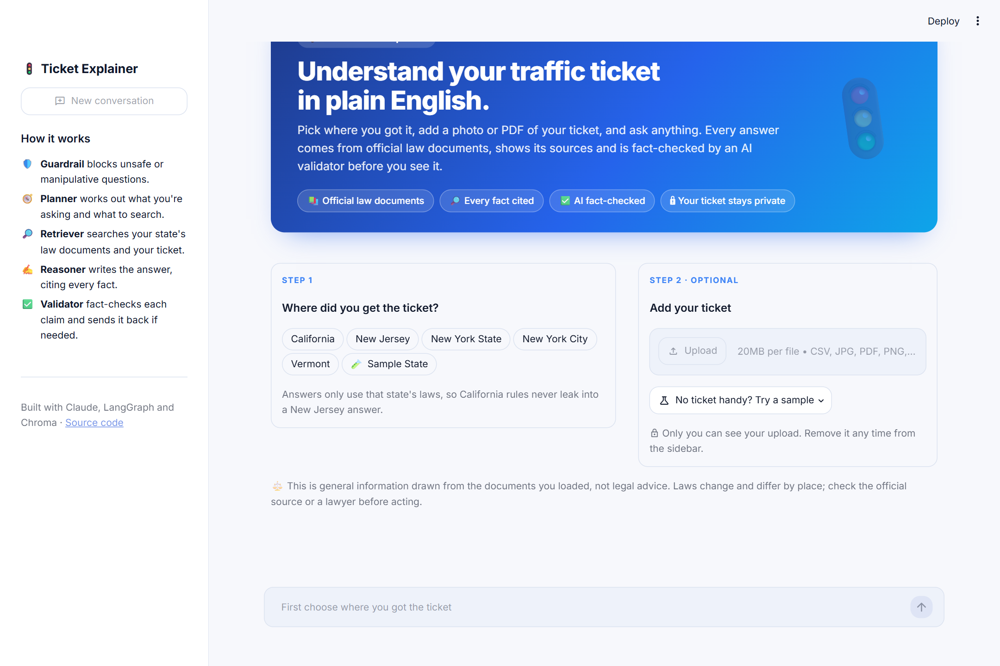

# 🚦 Traffic Ticket Explainer

**Understand your traffic ticket in plain English.** Pick where you got it (California, New Jersey,
New York State, New York City or Vermont), add a photo or file of your ticket, and ask anything:
"What does VC 22350 mean?", "How many points is this?", "Should I pay or go to traffic school?".
Answers come only from official law documents, cite every fact, and are fact-checked by a validator
agent before you see them.

**Live app:** https://traffic-ticket-explainer-4qkvqqetj69jbmgtazzj5m.streamlit.app/

Built for the Generative AI and ML capstone: LLM (Claude via the Anthropic API) + RAG (Chroma vector
database with local embeddings) + agents (LangGraph: planner, retriever with tools, reasoner, validator,
and a ticket reader).

> General information, not legal advice.

Full documentation (setup, architecture, agent roles, deployment, evaluation, limitations, challenges):
[docs/DOCUMENTATION.md](docs/DOCUMENTATION.md)



## What it does

- **Ticket summary card**: upload a photo, PDF, text, CSV or Excel ticket and see the violation codes,
  dates, court and a countdown to the due date, with an *Add to calendar* button.
- **Cited, fact-checked answers**: every fact links to the passage it came from; a validator agent checks
  each claim and sends the search back for another round if needed.
- **Live agent progress**: watch the guardrail, planner, retriever, reasoner and validator work.
- **Useful shortcuts**: Explain my ticket, Compare my options (pay / traffic school / contest),
  Points and my licence, Missed the deadline; follow-up suggestions after every answer.
- **Keep it**: save any answer with its sources; rate answers with thumbs up or down.
- **Safe for a public link**: injection filter, refusal of unsafe requests, daily and per-visit limits,
  optional access code.

## Try it in one minute

On the live app, click **No ticket handy? Try a sample** and pick a format. The four sample tickets
(fictional *Sample State*) are in `sample_docs/`:

| File | Format | What it shows |
| --- | --- | --- |
| `sample_ticket.pdf` | PDF | Speeding 19 over plus phone use |
| `sample_ticket_red_light.txt` | Text | Red light plus seat belt (one has points, one does not) |
| `sample_ticket_stop_sign.csv` | CSV | Stop sign plus expired registration (a correctable "fix-it" item) |
| `sample_ticket_fix_it.xlsx` | Excel | Equipment fix-it ticket due within days (red deadline badge) |

More questions to try, including ones that should be blocked or declined: `sample_docs/demo_questions.md`.

## Run it in VS Code (about 10 minutes)

1. **Install** Python 3.11 or 3.12 and VS Code with the Python extension.
2. **Open the folder**: unzip the project, then in VS Code choose *File > Open Folder* and pick
   `traffic-ticket-explainer`.
3. **Create the environment**: open the terminal (*Terminal > New Terminal*) and run

   ```bash
   python -m venv .venv
   # Windows
   .venv\Scripts\activate
   # Mac / Linux
   source .venv/bin/activate
   pip install -r requirements-dev.txt
   ```

   If VS Code asks "select interpreter", pick the one in `.venv`. If PowerShell refuses to run the
   activate script, skip activation and use `.venv\Scripts\python.exe -m ...` for the commands below.
4. **Add your API key**: create a key at https://platform.claude.com (API usage is billed separately from
   a Claude.ai plan; a few dollars of credit is plenty). Copy `.env.example` to `.env` and paste the key:

   ```
   ANTHROPIC_API_KEY=sk-ant-...
   ```

   Never commit or share `.env`.
5. **Run**: press F5 and choose *Run Traffic Ticket Explainer*, or run
   `python -m streamlit run app.py`. Your browser opens at http://localhost:8501.
   The first run downloads the 80 MB embedding model once.
6. **Tests**: `python -m pytest -q` (51 tests, no API key needed; they use a fake Claude client).
7. **Evaluation** (optional, uses the real API): `python -m evaluation.run_eval` writes
   `evaluation/results.md`.

## Law documents

Each `laws/<STATE>/` folder holds that jurisdiction's documents: official driver manuals and fine
schedules plus restated points tables. The full list with links and status is in
[laws/SOURCES.md](laws/SOURCES.md). Add more from the app's sidebar (*Add official documents*) or by
copying files into the folder; they are indexed the next time someone selects that state.

## Project layout

```
app.py                 Streamlit UI (setup, ticket card, quick questions, chat, sources, live agent progress)
docqa/config.py        Settings from environment variables
docqa/ingest.py        PDF / TXT / CSV / Excel / image loaders and upload validation
docqa/chunking.py      Recursive text splitter with overlap, citation labels
docqa/store.py         Chroma vector store with local all-MiniLM-L6-v2 embeddings
docqa/library.py       Jurisdictions, per-state law library, private per-session uploads
docqa/llm.py           Claude client: structured output, tool calls, refusals, API errors
docqa/prompts.py       Prompts for each agent
docqa/agents.py        LangGraph workflow: guard > planner > retriever > reasoner > validator > finalize
docqa/ticket.py        Ticket reader agent, deadline badge, calendar file
docqa/guardrails.py    Input checks, prompt-injection filter, citation checks, disclaimer
docqa/usage.py         Daily and per-visit limits on AI requests
evaluation/            17 questions with expected facts, runner, latest results
laws/<STATE>/          Law documents per jurisdiction
sample_docs/           Fictional sample tickets in PDF, TXT, CSV and Excel, plus demo questions
tests/                 Pytest suite with a fake Claude client, including a headless UI test
docs/                  Documentation and screenshots
```
