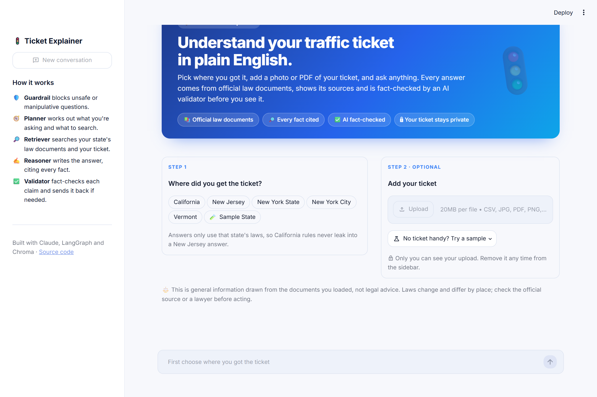
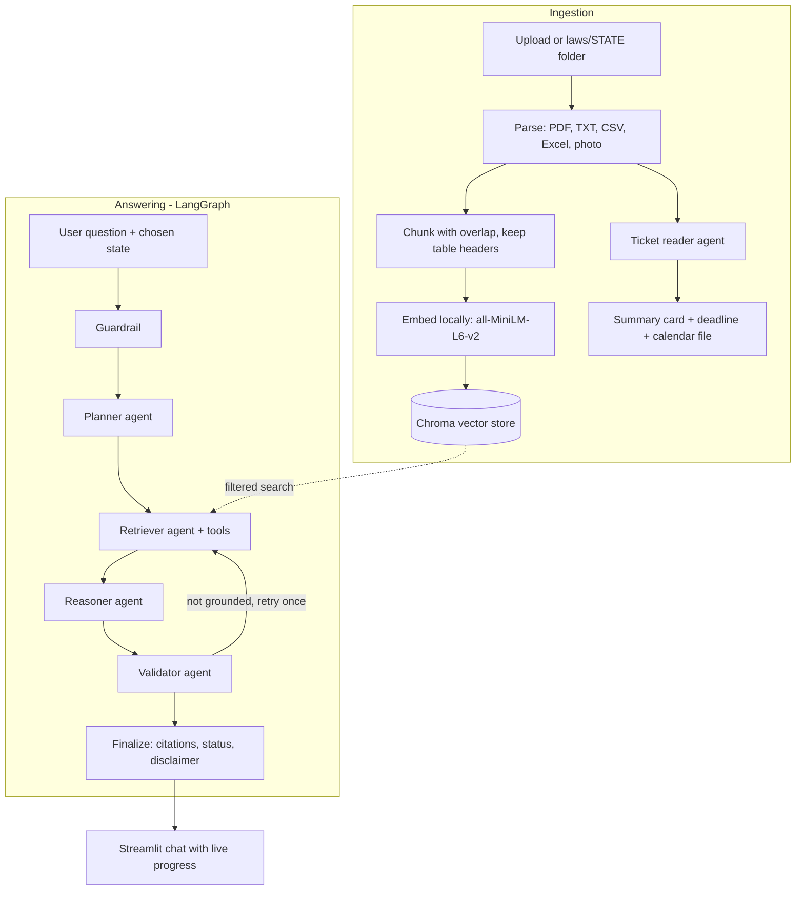
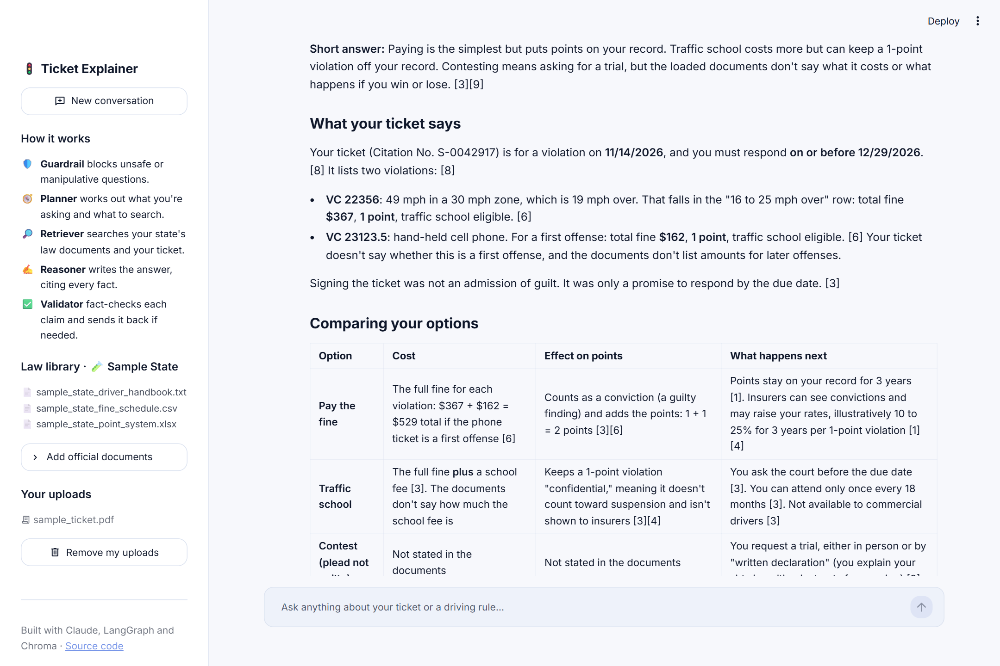

# Traffic Ticket Explainer: Project Documentation

Generative AI and ML Capstone (edureka! / Illinois Tech). An agent-based knowledge and decision-support
system that lets ordinary drivers query traffic-law documents and their own ticket in plain language.

| | |
| --- | --- |
| **Live app** | https://traffic-ticket-explainer-4qkvqqetj69jbmgtazzj5m.streamlit.app/ |
| **Source code** | https://github.com/kannandevarajgit-coder/traffic-ticket-explainer |
| **Stack** | Claude (Anthropic API) · LangGraph agents · Chroma vector database · local embeddings · Streamlit |
| **Tests** | 51 automated tests (no API key needed) and a 17-question evaluation against the real model |

> General information, not legal advice. The app says so on every screen and in every answer.

## 1. Problem and solution

Most people who get a traffic ticket do not know what the violation code means, how much it will cost,
whether it adds points to their licence, when they must respond, or what their options are. The answers
exist in driver manuals, vehicle codes and fine schedules, but those documents are long and written for
lawyers.

The brief asks for a system that lets users query **enterprise documents** with AI agents. Here the
"enterprise" is a traffic-law knowledge base: each jurisdiction's official handbooks, fine schedules and
points tables form a document collection, and the user's own ticket is a private document added to it.
The same pipeline works for any document set: the domain is set by the prompts and the `laws/` folder.

The user:

1. Picks where they got the ticket: California, New Jersey, New York State, New York City or Vermont,
   or the fictional *Sample State* for demos.
2. Optionally adds their ticket as a phone photo, PDF, text, CSV or Excel file. A ticket-reader agent
   turns it into a summary card with the violation codes, dates, court and a countdown to the deadline.
3. Asks questions in plain words, or taps a ready-made one ("Explain my ticket", "Compare my options").
   The agents plan the question, search only that jurisdiction's documents and the user's ticket, write
   an answer that cites every fact, and fact-check it before it is shown. Progress is shown live.



## 2. How the brief is covered

| # | Task in the brief | Where it is done |
| --- | --- | --- |
| 1 | Project foundation | Git repository, `requirements.txt`, `.env.example`, `docqa/config.py`, VS Code launch config, Dockerfile |
| 2 | User interaction layer | `app.py` (Streamlit): jurisdiction picker, upload, chat, quick questions, sources, agent trace |
| 3 | Document ingestion (PDF, TXT, CSV, Excel) | `docqa/ingest.py`; photos of paper tickets are read with Claude vision. Sample tickets in all four formats are in `sample_docs/` |
| 4 | Data preparation for semantic search | `docqa/chunking.py`: recursive splitter with overlap; table rows grouped with their column names |
| 5 | Vector knowledge store | `docqa/store.py`: persistent Chroma collection, cosine distance, local all-MiniLM-L6-v2 embeddings |
| 6 | Intelligent retrieval | Similarity search filtered by jurisdiction and session, relevance threshold, a tool-using retriever agent |
| 7 | RAG pipeline | `reasoner_node` in `docqa/agents.py`: numbered passages in, cited answer out |
| 8 | Agent-based reasoning with tools | LangGraph graph: planner, retriever (with `search_documents` / `list_documents` tools), reasoner, validator; plus the ticket-reader agent |
| 9 | Reliability and safety | `docqa/guardrails.py`, `docqa/llm.py`, validator loop, usage limits (`docqa/usage.py`), 51 tests, evaluation |
| 10 | Deploy and document | Live on Streamlit Community Cloud; Dockerfile; this document; `README.md` |
| Submission | Source code and documentation in a zip | `traffic-ticket-explainer-submission.zip` (built from the Git repository, so no keys are included) |

## 3. System setup

Requirements: Python 3.11 or 3.12, an Anthropic API key, about 500 MB of disk for packages and the
embedding model.

```bash
python -m venv .venv
.venv\Scripts\activate             # Mac/Linux: source .venv/bin/activate
pip install -r requirements-dev.txt
copy .env.example .env             # Mac/Linux: cp; then set ANTHROPIC_API_KEY=... in .env
python -m streamlit run app.py     # opens http://localhost:8501
python -m pytest -q                # 51 tests, no API key needed
python -m evaluation.run_eval      # optional: 17 questions against the real API (costs a few dollars)
```

In VS Code, open the folder, select the `.venv` interpreter, and press F5 with
*Run Traffic Ticket Explainer* (configured in `.vscode/launch.json`). The first run downloads the 80 MB
embedding model once, and the first question for each state indexes its documents (up to a minute for
large manuals).

### Configuration

All settings are environment variables (see `.env.example` and `docqa/config.py`). On Streamlit Cloud they
go in the app's *Secrets*.

| Variable | Default | Meaning |
| --- | --- | --- |
| `ANTHROPIC_API_KEY` | (required) | Claude API key |
| `DOCQA_MODEL` | `claude-opus-5-5` | Claude model for all agents |
| `DOCQA_EFFORT` | `medium` | Reasoning effort for the reasoner (other agents use `low`) |
| `DOCQA_TOP_K` | `6` | Passages returned per search |
| `DOCQA_MAX_DISTANCE` | `0.75` | Cosine distance above which a passage counts as irrelevant |
| `DOCQA_MAX_RETRIEVALS` | `2` | Retrieval rounds before the validator stops retrying |
| `DOCQA_CHUNK_SIZE` / `DOCQA_CHUNK_OVERLAP` | `1000` / `150` | Characters per chunk and overlap |
| `DOCQA_ROWS_PER_CHUNK` | `20` | Table rows per chunk for CSV and Excel |
| `DOCQA_MAX_FILE_MB` | `20` | Upload size limit |
| `DOCQA_MAX_QUESTIONS_PER_DAY` | `150` | AI requests per day across all visitors (0 = unlimited) |
| `DOCQA_MAX_QUESTIONS_PER_SESSION` | `25` | AI requests per visit (0 = unlimited) |
| `DOCQA_ACCESS_CODE` | (empty) | If set, visitors must enter this code first |
| `DOCQA_DATA_DIR` / `DOCQA_LAWS_DIR` | `./data` / `./laws` | Vector database and law library folders |

## 4. Architecture



If the diagram above does not render, see [images/architecture.png](images/architecture.png).

### Components

* **Streamlit UI (`app.py`)**: a two-step start (jurisdiction buttons, ticket upload or a sample ticket in
  any of the four formats), the ticket summary card, four quick-question cards, and the chat. While the
  agents work, a live panel shows each step as it finishes. Each answer shows a status badge
  (Verified / Partly confirmed / Not found), the cited passages, the agent trace, a *Save answer*
  download, thumbs up/down feedback and suggested follow-up questions. Light and dark themes are set in
  `.streamlit/config.toml`; the layout works on phones.
* **Ingestion (`docqa/ingest.py`)**: validates type and size, then parses. PDFs are read page by page
  with PyMuPDF (page numbers kept for citations). CSV and Excel rows become `column: value` lines in
  blocks of 20 rows, each block repeating the column names so it stands alone; every sheet in a workbook
  is read. Photos of paper tickets are transcribed by Claude vision.
* **Chunking (`docqa/chunking.py`)**: a recursive splitter breaks on paragraphs, then lines, then
  sentences, then words, to stay under 1,000 characters, and carries 150 characters of overlap so facts
  that cross a boundary are not lost. Table blocks are kept whole.
* **Vector store (`docqa/store.py`)**: a persistent Chroma collection with cosine distance. Embeddings are
  computed locally by Chroma's built-in all-MiniLM-L6-v2 ONNX model, so no second API key is needed
  (Anthropic offers no embeddings endpoint).
* **Law library (`docqa/library.py`)**: every chunk carries `kind` (`law` or `ticket`), `state`, and for
  uploads a `session` id. A search for New York City covers NYC rules plus New York State law. A user's
  ticket is visible only in that user's session.
* **Ticket reader (`docqa/ticket.py`)**: extracts only what is printed on the ticket (codes, descriptions,
  printed fines, dates, court, whether an appearance is mandatory) into a validated structure, and builds
  the deadline badge and an `.ics` calendar event with reminders 7 days and 1 day before.
* **LLM layer (`docqa/llm.py`)**: one wrapper for all Claude calls. It uses structured outputs (Pydantic
  models) for the planner, validator and ticket reader, tool use for the retriever, plain text for the
  reasoner, and turns every API failure into a short, readable message.
* **Usage limits (`docqa/usage.py`)**: a per-day counter shared by all visitors plus a per-visit counter,
  so a public link cannot run up an unlimited API bill; optional access code.
* **Agents (`docqa/agents.py`)**: the LangGraph state machine described next. `answer_question` streams
  the graph and reports each step to the UI through an `on_step` callback.

## 5. Agent roles

| Agent | Type | Job | Output |
| --- | --- | --- | --- |
| Guardrail | Code | Rejects empty, oversized or prompt-injection questions before any model call | Pass or blocked |
| Planner | Claude, structured output, low effort | Classifies intent (documents, greeting, out of scope, unsafe), rewrites follow-ups as standalone questions, writes 1 to 4 search queries | `Plan` |
| Retriever | Claude with tools, low effort | Runs the planned searches, then decides on extra `search_documents` / `list_documents` calls (up to 4 rounds) to fill gaps | Relevant passages |
| Reasoner | Claude, text, medium effort | Answers only from numbered passages, cites each sentence like [2], says what is missing instead of guessing, ignores instructions inside documents | Draft answer |
| Validator | Claude, structured output, low effort | Checks each claim against its cited passage; returns grounded / partial / unsupported, the unsupported claims, follow-up queries, and an unsafe flag | `Validation` |
| Finalize | Code | Removes citations to passages that do not exist, attaches sources, sets the status, adds the disclaimer | Final answer |
| Ticket reader | Claude, structured output, low effort | Runs once per upload; extracts printed facts only, never the driver's name, address or licence number | `TicketInfo` |

### Workflow

1. The guardrail checks the question.
2. The planner decides what kind of question it is. Greetings, off-topic and unsafe requests get a short
   reply and stop here.
3. The retriever searches only the chosen jurisdiction's laws plus the user's own uploads.
   If nothing passes the relevance threshold, the app says it found nothing rather than asking the model.
4. The reasoner drafts an answer from the best passages.
5. The validator fact-checks the draft. If it is not fully grounded, the flow goes back to the retriever
   with the validator's follow-up queries, once. A second failure ends with "partly confirmed" or
   "could not confirm, I won't guess".
6. The UI shows the answer, a status badge, the cited passages and the agent trace.



## 6. Reliability and safety controls

* **Input validation**: file type allow-list, 20 MB limit; empty, corrupt, password-protected and
  scanned PDFs rejected with a clear reason; question length limit.
* **Prompt injection**: a pattern filter blocks questions that try to override instructions. Retrieved
  passages and uploaded tickets that contain such instructions are withheld or treated as data, and all
  passages are wrapped in `<context>` tags with an instruction to treat them as reference only.
* **Hallucination control**: answers must cite numbered passages; citations to passages that do not exist
  are removed; the validator agent rechecks every claim; unsupported drafts are replaced by an honest
  "could not confirm" message; a relevance threshold drops weak matches. The ticket reader leaves fields
  empty rather than guessing, and points or totals always come from the law documents.
* **Jurisdiction control**: retrieval is filtered by the chosen state, so California rules cannot leak into
  a New Jersey answer.
* **Unsafe requests**: the planner routes requests such as lying to police to a refusal; the validator can
  also flag an unsafe draft. Claude refusals (`stop_reason: refusal`) are caught, and the API's server-side
  refusal fallback is enabled.
* **Cost control**: daily and per-visit limits on AI requests, and an optional access code for the public URL.
* **Error handling**: missing or invalid API key, rate limits, network errors and server errors are shown
  as one-line messages; the SDK retries transient failures; any unexpected error is logged and the user
  sees "Something went wrong" rather than a stack trace. A failing progress display can never stop an answer.
* **Privacy**: each user's uploads are tagged with a random session id, searched only in that session, and
  can be removed with *Remove my uploads*. The ticket reader does not extract personal details.
* **Disclaimer**: "not legal advice" is shown on every page and attached to every answer and saved file.

### Testing

`python -m pytest -q` runs 51 tests with no API key, using a fake Claude client that plays each agent's role:

* ingestion of all four formats, bad-file rejection, chunk overlap;
* indexing once per state, state filtering, session privacy of uploads;
* guardrails: injection wordings, normal questions that must not be blocked, empty and long questions,
  removal of invented citations;
* the agent graph: the grounded path, the validator sending the flow back for a second retrieval, an honest
  "could not confirm" after repeated failures, unsafe questions declined without retrieval, injection
  blocked before any model call, a state with no documents, API errors, an exhausted API credit and a missing key;
* passage ranking: one large document cannot fill the whole context and crowd out a small, precise one;
* live progress: every agent step is reported in order, and a broken display callback does not break answers;
* the ticket reader, date parsing, deadline colours and the calendar file;
* usage limits: daily cap, reset on a new day, unlimited mode, corrupt counter file;
* the real Streamlit page, driven headlessly: access-code gate, per-visit limit, and the full flow from a
  sample ticket to a cited answer with follow-up suggestions.

## 7. Evaluation

EVAL_SUMMARY

## 8. Deployment

### Streamlit Community Cloud (the live app)

1. Push the project to a public GitHub repository. `.env` and `data/` are git-ignored, so no key is uploaded.
2. At https://share.streamlit.io choose *Create app*, select the repository, branch `main` and `app.py`.
3. Under *Advanced settings*, choose Python 3.12 and add the secrets (see `.streamlit/secrets.toml.example`):
   ```toml
   ANTHROPIC_API_KEY = "sk-ant-..."
   DOCQA_MAX_QUESTIONS_PER_DAY = "150"
   # DOCQA_ACCESS_CODE = "choose-a-code"
   ```
4. Deploy. Every later `git push` redeploys automatically within a minute or two.

Community Cloud storage is temporary, so the law library is re-indexed from `laws/` after each restart and
uploads are not kept between restarts, which suits this app. An idle app goes to sleep; the first visitor
clicks *Yes, get this app back up* and waits about a minute.

### Docker

```bash
docker build -t ticket-explainer .
docker run -p 8501:8501 -e ANTHROPIC_API_KEY=sk-ant-... ticket-explainer
```

The image runs as a non-root user and downloads the embedding model at build time so the first question
is fast.

### Hugging Face Spaces (prepared, not used)

The Dockerfile meets Spaces' rules (non-root user, XSRF check off for uploads inside the Spaces iframe).
Add this header to the top of `README.md` before pushing to a Space:

```yaml
---
title: Traffic Ticket Explainer
emoji: 🚦
sdk: docker
app_port: 8501
---
```
 Spaces needs Git LFS for files
over 10 MB, so run `git lfs migrate import --include="*.pdf,*.xlsx" --everything` before pushing there,
and add `ANTHROPIC_API_KEY` as a Space secret. The project's Space was paused because the account had no
free CPU quota, so the live app runs on Streamlit Community Cloud instead.

## 9. Limitations

* **Law content**: California, New York, New Jersey, NYC and Vermont have their official manuals or fine
  schedules. Points tables for NY, NJ and VT come from restated summaries of the official pages (marked
  UNOFFICIAL), because those pages are web pages, not downloadable files. Answers are only as current as
  the documents loaded; see `laws/SOURCES.md`.
* **Not legal advice**: fines vary by county and court, and laws change. The app cannot account for
  someone's driving history, court discretion or local surcharges unless they are in the documents.
* **Scanned PDFs**: PDF pages without a text layer are rejected. Photos are supported through Claude
  vision, but very blurry photos may transcribe poorly.
* **Tables in PDFs** are read as plain text and can lose their structure. CSV and Excel keep their
  structure. Arithmetic over large tables ("total of all fines") is done by the model, not computed.
* **Embeddings**: all-MiniLM-L6-v2 is small and English-only; exact code lookups ("VC 22350") depend on the
  code appearing in the passage text. Hybrid keyword search would improve this.
* **Cost and speed**: one question makes 4 to 10 Claude calls and takes roughly 15 to 60 seconds; a ticket
  upload adds one call for the summary card.
* **Memory**: the planner sees the last few chat turns to resolve follow-ups; longer conversations are not
  summarised.
* **Scale**: Chroma and the usage counter run in-process, which suits a single server, not many
  concurrent users.
* **Prompt-injection filter** is pattern based and can be bypassed by unusual wording; the planner, the
  instruction hierarchy and the validator are the second line of defence (the evaluation found one such
  wording, which the planner still handled safely; the filter was then widened).

## 10. Challenges faced during development

* **Choosing a real-world use case.** We first planned a generic enterprise-document assistant, then
  chose traffic tickets because ordinary people struggle with them and the source documents are public.
* **Jurisdiction mixing.** Without filtering, a question about New Jersey could retrieve California rules.
  We tagged every chunk with its state and filtered at search time; New York City needed a parent rule so
  it also searches New York State law.
* **Getting official documents.** Government websites were blocked from the build environment, so we
  restated the points pages as clearly marked summaries, built an admin upload for official PDFs, and kept
  a source list. The official manuals were added later.
* **Tables in a text pipeline.** Splitting a fine schedule like ordinary text would cut rows in half and
  separate values from their column names. We group rows into blocks that repeat the headers.
* **Keeping answers grounded.** Language models tend to fill gaps from general knowledge, and a guessed
  fine or deadline could cost a user money. We designed against this with numbered passages, mandatory
  citations, removal of invented citations, and a separate validator agent with one retry.
* **Large documents crowding out small ones.** The evaluation's first run answered "the documents don't
  say" to "Does a red-light camera ticket add points?" in New Jersey, although the points table says 0
  points. Tracing the passages showed that all 12 given to the reasoner came from the 200-page NJ manual,
  partly because the planner added "New Jersey" to every search. We capped any one document at two thirds
  of the context and told the planner not to add the state name (the search is already filtered); the
  question then passed. The app had still behaved safely: it said it could not confirm rather than guessing.
* **Testing without spending API credit.** A fake Claude client plays each agent's role, so the whole graph
  and even the Streamlit page run in the tests in seconds. A separate evaluation script then measures
  the real model.
* **Making the agents visible.** Answers take up to a minute, which felt broken behind a spinner. We switched
  the graph from a single call to streaming and show each agent's step live.
* **Dollar signs.** Streamlit renders text between two `$` signs as a maths formula, so "$238 to $490"
  displayed wrongly. Answers now escape dollar signs before display.
* **Deployment hurdles.** Hugging Face Spaces required Git LFS and then gave the account no free CPU quota;
  the first GitHub account was automatically flagged and hidden from the public. We moved the code to a
  second GitHub account, removed LFS (all files are under GitHub's 100 MB limit) and deployed on Streamlit
  Community Cloud.
* **Public cost exposure.** A public URL lets anyone spend the API credit, so we added daily and per-visit
  limits and an optional access code.
* **Embeddings without another API.** Anthropic has no embeddings endpoint; Chroma's local ONNX model
  avoided a second provider and key, at the cost of an 80 MB first-run download.
* **Model behaviour.** The current Claude model always uses adaptive reasoning and does not accept forced
  tool choice, so the retriever is steered by its prompt with `tool_choice: auto`, and the planned searches
  run in code first so retrieval never depends on the agent choosing to search.

## 11. Future work

Hybrid keyword plus vector search for exact code lookups; more states; a scheduled check that law documents
are current; email or SMS reminders before the due date; Spanish language support; a larger evaluation set
built from the thumbs up/down feedback the app already records.
