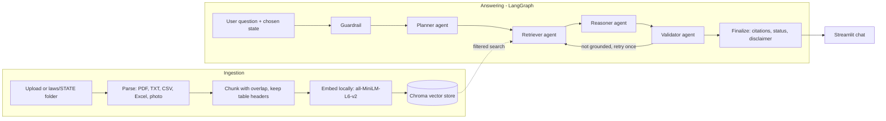

# Traffic Ticket Explainer: Project Documentation

Generative AI and ML Capstone. An agent-based knowledge and decision-support system that lets ordinary
drivers query traffic-law documents in plain language.

## 1. Problem and solution

Most people who get a traffic ticket do not know what the violation code means, how much it will cost,
whether it adds points to their licence, or what they can do about it. The answers exist in driver
manuals, vehicle codes and fine schedules, but those documents are long and written for lawyers.

The Traffic Ticket Explainer lets a user:

1. Pick where they got the ticket: California, New Jersey, New York State, New York City, or Vermont
   (plus a fictional *Sample State* for demos).
2. Optionally upload the ticket itself as a PDF, a phone photo, text, CSV or Excel file.
3. Ask questions in plain words. AI agents plan the question, search that jurisdiction's law documents
   and the user's ticket, write an answer that cites every fact, and fact-check it before showing it.

It is general information, not legal advice, and the app says so on every screen.

## 2. How the brief's ten tasks are covered

| # | Task | Where |
| --- | --- | --- |
| 1 | Project foundation | Repo layout, `requirements.txt`, `.env.example`, `docqa/config.py`, VS Code configs |
| 2 | User interaction layer | `app.py` (Streamlit): state dropdown, upload, chat, sources, agent trace |
| 3 | Document ingestion (PDF, TXT, CSV, Excel) | `docqa/ingest.py`; photos of paper tickets are read with Claude vision |
| 4 | Data preparation for semantic search | `docqa/chunking.py`: recursive splitter with overlap; table rows grouped with their headers |
| 5 | Vector knowledge store | `docqa/store.py`: Chroma, persistent, cosine distance, local embeddings |
| 6 | Intelligent retrieval | Similarity search filtered by jurisdiction and session, relevance threshold, a tool-using retriever agent |
| 7 | RAG pipeline | `reasoner_node` in `docqa/agents.py`: numbered passages in, cited answer out |
| 8 | Agent-based reasoning | LangGraph graph with planner, retriever, reasoner and validator agents |
| 9 | Reliability and safety | `docqa/guardrails.py`, `docqa/llm.py`, validator loop, refusal handling, tests |
| 10 | Deploy and document | `Dockerfile`, Streamlit Cloud steps below, this document, `README.md` |

## 3. System setup

Requirements: Python 3.11 or newer, an Anthropic API key, about 500 MB of disk for packages and the
embedding model.

```bash
python -m venv .venv
source .venv/bin/activate        # Windows: .venv\Scripts\activate
pip install -r requirements-dev.txt
cp .env.example .env             # then put ANTHROPIC_API_KEY=... in .env
streamlit run app.py             # opens http://localhost:8501
pytest -q                        # 25 tests, no API key needed
```

In VS Code, open the folder, select the `.venv` interpreter, and press F5 with
*Run Traffic Ticket Explainer* (configured in `.vscode/launch.json`).

### Configuration

All settings are environment variables (see `.env.example` and `docqa/config.py`).

| Variable | Default | Meaning |
| --- | --- | --- |
| `ANTHROPIC_API_KEY` | (required) | Claude API key |
| `DOCQA_MODEL` | `claude-opus-5-5` | Claude model for all agents |
| `DOCQA_EFFORT` | `medium` | Reasoning effort for the reasoner (other agents use `low`) |
| `DOCQA_TOP_K` | `6` | Passages returned per search |
| `DOCQA_MAX_DISTANCE` | `0.75` | Cosine distance above which a passage counts as irrelevant |
| `DOCQA_MAX_RETRIEVALS` | `2` | Retrieval rounds before the validator stops retrying |
| `DOCQA_CHUNK_SIZE` / `DOCQA_CHUNK_OVERLAP` | `1000` / `150` | Characters per chunk and overlap |
| `DOCQA_ROWS_PER_CHUNK` | `20` | Table rows per chunk for CSV and Excel |
| `DOCQA_MAX_FILE_MB` | `20` | Upload size limit |
| `DOCQA_DATA_DIR` / `DOCQA_LAWS_DIR` | `./data` / `./laws` | Vector database and law library folders |

## 4. Architecture



### Components

* **Streamlit UI (`app.py`)**: state dropdown, ticket upload, chat, an expandable list of sources for each
  answer, and an expandable "How the agents worked" trace. An admin panel adds official law documents
  for the selected state.
* **Ingestion (`docqa/ingest.py`)**: validates type and size, then parses. PDFs are read page by page
  with PyMuPDF (page numbers kept for citations). CSV and Excel rows become `column: value` lines in
  blocks of 20 rows, each block repeating the column names so it stands alone. Every sheet in a
  workbook is read. Photos of paper tickets are transcribed by Claude vision.
* **Chunking (`docqa/chunking.py`)**: a recursive splitter breaks on paragraphs, then lines, then
  sentences, then words, to stay under 1,000 characters, and carries 150 characters of overlap so facts
  that cross a boundary are not lost. Table blocks are kept whole.
* **Vector store (`docqa/store.py`)**: a persistent Chroma collection with cosine distance. Embeddings are
  computed locally by Chroma's built-in all-MiniLM-L6-v2 ONNX model, so no second API key is needed and
  Anthropic (which offers no embeddings endpoint) is only used for reasoning.
* **Law library (`docqa/library.py`)**: every chunk carries `kind` (`law` or `ticket`), `state`, and for
  uploads a `session` id. A search for New York City covers NYC rules plus New York State law. A user's
  ticket is visible only in that user's session.
* **LLM layer (`docqa/llm.py`)**: one wrapper for all Claude calls. It uses structured outputs (Pydantic
  models) for the planner and validator, tool use for the retriever, plain text for the reasoner, and
  turns every API failure into a short, readable message.
* **Agents (`docqa/agents.py`)**: the LangGraph state machine described next.

## 5. Agent roles

| Agent | Type | Job | Output |
| --- | --- | --- | --- |
| Guardrail | Code | Rejects empty, oversized or prompt-injection questions before any model call | Pass or blocked |
| Planner | Claude, structured output, low effort | Classifies intent (documents, greeting, out of scope, unsafe), rewrites follow-ups as standalone questions, writes 1 to 4 search queries | `Plan` |
| Retriever | Claude with tools, low effort | Runs the planned searches, then decides on extra `search_documents` / `list_documents` calls (up to 4 rounds) to fill gaps | Relevant passages |
| Reasoner | Claude, text, medium effort | Answers only from numbered passages, cites each sentence like [2], says what is missing instead of guessing, ignores instructions inside documents | Draft answer |
| Validator | Claude, structured output, low effort | Checks each claim against its cited passage; returns grounded / partial / unsupported, the unsupported claims, follow-up queries, and an unsafe flag | `Validation` |
| Finalize | Code | Removes citations to passages that do not exist, attaches sources, sets the status, adds the disclaimer | Final answer |

### Workflow

1. The guardrail checks the question.
2. The planner decides what kind of question it is. Greetings, off-topic and unsafe requests get a short
   reply and stop here.
3. The retriever searches only the chosen jurisdiction's laws plus the user's own uploads.
   If nothing passes the relevance threshold, the app says it found nothing rather than asking the model.
4. The reasoner drafts an answer from the best passages.
5. The validator fact-checks the draft. If it is not fully grounded, the flow goes back to the retriever
   with the validator's follow-up queries, once. A second failure ends with "partly confirmed"
   or "could not confirm, I won't guess".
6. The UI shows the answer, a status badge, the cited passages and the agent trace.

## 6. Reliability and safety controls

* **Input validation**: file type allow-list, 20 MB limit, empty, corrupt, password-protected and
  scanned PDFs rejected with a clear reason; question length limit.
* **Prompt injection**: a pattern filter blocks questions that try to override instructions. Retrieved
  passages that contain such instructions are withheld from the model, and all passages are wrapped in
  `<context>` tags with an instruction to treat them as data.
* **Hallucination control**: answers must cite numbered passages; citations to passages that do not exist
  are removed; the validator agent rechecks every claim; unsupported drafts are replaced by an honest
  "could not confirm" message; a relevance threshold drops weak matches.
* **Jurisdiction control**: retrieval is filtered by the chosen state, so California rules cannot leak into
  a New Jersey answer.
* **Unsafe requests**: the planner routes requests such as evading police to a refusal; the validator can
  also flag an unsafe draft. Claude refusals (`stop_reason: refusal`) are caught, and the API's server-side
  refusal fallback is enabled.
* **Error handling**: missing or invalid API key, rate limits, network errors and server errors are shown
  as one-line messages; the SDK retries transient failures; any unexpected error is logged and the user
  sees "Something went wrong" rather than a stack trace.
* **Privacy**: each user's uploads are tagged with a random session id, searched only in that session, and
  can be removed with *Remove my uploads*.
* **Disclaimer**: "not legal advice" is shown on every page and attached to every answer.

### Testing

`pytest -q` runs 25 tests with no API key, using a fake Claude client:

* ingestion of all four formats, bad-file rejection, chunk overlap;
* indexing once per state, state filtering, session privacy of uploads;
* guardrails: injection, empty and long questions, removal of invented citations;
* the agent graph: the grounded path, the validator sending the flow back for a second retrieval,
  an honest "could not confirm" after repeated failures, unsafe questions declined without retrieval,
  injection blocked before any model call, a state with no documents, API errors and a missing key.

The request format sent to the Anthropic API was also checked against a local mock server.

## 7. Deployment

### Local (Windows, Mac, Linux)

See section 3. Data is stored in `./data`; delete it to rebuild the index.

### Docker

```bash
docker build -t ticket-explainer .
docker run -p 8501:8501 -e ANTHROPIC_API_KEY=sk-ant-... ticket-explainer
```

The image downloads the embedding model at build time so the first question is fast.

### Streamlit Community Cloud (free public URL)

1. Push the project to a GitHub repository. `.env` and `data/` are git-ignored.
2. At https://share.streamlit.io choose *Create app*, select the repository, branch and `app.py`.
3. Under *Advanced settings > Secrets*, add `ANTHROPIC_API_KEY = "sk-ant-..."`
   (see `.streamlit/secrets.toml.example`).
4. Deploy. The app reads the key from Streamlit secrets.

Note: Community Cloud storage is temporary, so the law library is re-indexed from `laws/` after each
restart. User uploads are not kept between restarts, which suits this app.

## 8. Limitations

* **Law content**: the build environment could not download government files, so the official manuals and
  fine schedules must be added from the links in `laws/SOURCES.md`. Until then the NY, NJ, VT and NYC
  folders contain restated summaries of official points and fines pages (marked UNOFFICIAL) and California
  has none. Answers are only as current as the documents loaded.
* **Not legal advice**: fines vary by county and court, and laws change. The app cannot account for
  someone's driving history, court discretion or local surcharges unless they are in the documents.
* **Scanned PDFs**: PDF pages without a text layer are rejected. Photos are supported through Claude
  vision, but very blurry photos may transcribe poorly.
* **Tables**: tables inside PDFs are read as plain text and can lose their structure. CSV and Excel keep
  their structure. Numeric questions over large tables ("total of all fines") are not computed.
* **Embeddings**: all-MiniLM-L6-v2 is small and English-only; exact code lookups ("VC 22350") depend on the
  code appearing in the passage text. Hybrid keyword search would improve this.
* **Live testing**: the automated tests use a fake Claude client; end-to-end behaviour with the real API
  should be checked with your own key and the questions in `sample_docs/`.
* **Cost and speed**: one question makes 4 to 10 Claude calls and takes roughly 15 to 60 seconds.
* **Memory**: the planner sees the last few chat turns to resolve follow-ups; longer conversations are not
  summarised.
* **Scale**: Chroma runs in-process, which suits a single server, not many concurrent users.
* **Prompt-injection filter** is pattern based and can be bypassed by unusual wording; the instruction
  hierarchy and the validator are the second line of defence.

## 9. Challenges faced during development

* **Choosing a real-world use case.** We first planned a generic enterprise-document assistant, then
  chose traffic tickets because ordinary people struggle with them and the source documents are public.
* **Jurisdiction mixing.** Without filtering, a question about New Jersey could retrieve California rules.
  We tagged every chunk with its state and filtered at search time; New York City needed a parent rule so
  it also searches New York State law.
* **Getting official documents.** Government websites were blocked from the build environment, so we
  restated the points pages as clearly-marked summaries, built an admin upload for official PDFs, and kept
  a source list.
* **Tables in a text pipeline.** Splitting a fine schedule like ordinary text would cut rows in half and
  separate values from their column names. We group rows into blocks that repeat the headers, so each
  chunk can be understood on its own.
* **Keeping answers grounded.** Language models tend to fill gaps from general knowledge, and a guessed
  fine or deadline could cost a user money. We designed against this with numbered passages, mandatory
  citations, removal of invented citations, and a separate validator agent with one retry, so the app
  says "the documents do not say" instead of guessing.
* **Testing without spending API credit.** We wrote a fake Claude client that plays each agent's role, so
  the whole graph, including retry and failure paths, runs in the tests in seconds.
* **Error messages.** A missing API key first surfaced as a long stack trace in the UI; we added an
  explicit key check and a catch-all so users always see one readable sentence.
* **Embeddings without another API.** Anthropic has no embeddings endpoint; Chroma's local ONNX model
  avoided a second provider and key, at the cost of an 80 MB first-run download.
* **Model behaviour.** The current Claude model always uses adaptive reasoning and does not accept forced
  tool choice, so the retriever is steered by its prompt with `tool_choice: auto`, and the planned searches
  run in code first so retrieval never depends on the agent choosing to search.

## 10. Future work

Hybrid keyword plus vector search for exact code lookups; more states; a scheduled check that law
documents are current; reminder of the ticket's due date; Spanish language support; an evaluation set of
real ticket questions with expected answers.
